# Oliver's Software Engineer Portfolio 
(Updated 16th October 2026)  

# [Oliver's Resume](https://github.com/Ober3550/Ober3550/blob/master/OliverMainey_SoftwareEngineer_2025_08_21.md)
<!-- ## Introduction  
I'm Oliver, a recent graduate of Information Technology majoring in Computer Science and Simulation Science. I have a strong passion for high performance and mathematically based systems. My Inspirations are Jonathan Blow, Andrei Alexandrescu and Mike Acton (aswell as many of the great speakers at CPP Con). These people consistently challenge the fundamental ideas of what it means to focus on performance improving the software industry to atleast try and utilize some of the sheer computation that modern hardware provides (and isn't always used well). I am always working on something, whether it be a small, medium, or large sized project. I focus on learning new technologies to increase my expertise, improving my work ethic and flexing my brain with problem solving whenever I can.  -->

### "Want fast C++? Know your hardware!" - Timur Doumler cppcon 2016  
<!-- ## [Stock Screener](https://finviz.com/screener.ashx?v=150&f=fa_debteq_u1,fa_pe_profitable&ft=4&o=-dividendyield) -->

    
<h2 style="display:inline">Amazing Lectures about Technology</h2>

<!-- catalog:start -->
## Contents
- [Space](#space)
- [High Performance Computing](#high-performance-computing)
- [Low Performance Computing](#low-performance-computing)
- [Artifical Intelligence](#artifical-intelligence)
- [Computer Science](#computer-science)
- [Simulation Science](#simulation-science)
- [Science & Engineering](#science--engineering)
- [Computing Hardware](#computing-hardware)
- [Corporate Secrets](#corporate-secrets)
- [Cybersecurity](#cybersecurity)
- [Fun Projects](#fun-projects)

| | | |
| - | - | - |
| <h2>Space</h2> | | |
| <h4>SpaceX - Starship SN8 High Altitude Flight Test</h4> | <h4>Scott Manley - Starship SN8 Spectacular Flight</h4> | <h4>SpaceX - Starship SN10 High Altitude Flight Test</h4> |
|  |  |  |
| <h4>SpaceX - Starship Flight Test</h4> | <h4>Everyday Astronaut - SpaceX Tour with Elon Part 1</h4> | <h4>Everyday Astronaut - SpaceX Tour with Elon Part 2</h4> |
|  |  |  |
| <h4>Everyday Astronaut - SpaceX Tour with Elon Part 3</h4> | <h4>Everyday Astronaut - SpaceX Elon explains the Merlin Engine</h4> | <h4>Everyday Astronaut - SpaceX Elon explains the Raptor Engine</h4> |
|  |  |  |
| <h4>Everyday Astronaut - SpaceX Raptor Engine Development Upgrades</h4> | <h4>Everyday Astronaut - SpaceX Starship vs N1 Is Starship doomed to repeat history?</h4> | <h4>RocketLab - Lift Off!</h4> |
|  |  |  |
| <h4>Everyday Astronaut - A chat with Rocket Lab's CEO Peter Beck about Neutron</h4> | <h4>Everyday Astronaut - Talking about Rocket Lab's Neutron with Peter Beck</h4> | <h4>Everyday Astronaut - The Entire Soviet Rocket Engine Family Tree</h4> |
|  |  |  |
| <h4>Everyday Astronaut - Rocket engine cycles: How do you power a rocket engine?</h4> | <h4>Everyday Astronaut - How Stoke Space's Unique Rocket Works</h4> | <h4>Everyday Astronaut - Tour Firefly Aerospace's Factory and Test Site with their CEO Tom Markusic</h4> |
|  |  |  |
| <h4>Everyday Astronaut - Why Starting A Rocket Engine Is So Hard</h4> | <h4>Everyday Astronaut - Orbits vs Sub-Orbit</h4> | <h4>Entropian - Realistic interstellar journey</h4> |
|  |  |  |
| <h4>Rational Animations - How to Take Over the Universe (in Three Easy Steps)</h4> | <h4>Rational Animations - Grabby Aliens</h4> | <h4>Rational Animations - Sorting Pebbles Into Correct Heaps</h4> |
|  |  |  |
| <h4>Rational Animations - The Power of Intelligence</h4> | <h4>Rational Animations - Everything might change forever this century (or we'll go extinct)</h4> | <h4>Rational Animations - Longtermism: an idea that could save 100 billion trillion lives</h4> |
|  |  |  |
| <h4>Rational Animations - Can we make the future a million years from now go better?</h4> | <h4>David Kipping - Alien Civilisations and Habitable Worlds</h4> | <h4>David Kipping - Why Starship Could Transform Astronomy</h4> |
|  |  |  |
| <h4>David Kipping - How Game Theory Can Help Us Find Aliens</h4> | <h4>David Kipping - The problem with "The Rare Earth Hypothesis"</h4> | <h4>David Kipping - The First Civilization To Emerge in the Galaxy</h4> |
|  |  |  |
| <h4>David Kipping - What if Intelligence Re-emerges?</h4> | <h4>David Kipping - Why don't we live around a red dwarf when they're the most common type of star?</h4> | <h4>David Kipping - Why we may be surrounded by older alien civilizations</h4> |
|  |  |  |
| <h4>Dr Becky - JWST has found MASSIVE galaxies in the early Universe</h4> | <h4>Dr Becky - JWST's Successor The Carl Sagan Observatory</h4> | <h4>Subject Zero Science - Would it work? RAILGUN Assisted Orbital Launcher</h4> |
|  |  |  |
| <h4>Summit - Running the Algorithm: SpaceX’s Approach to Exponential Growth with VP of Launch Kiko Dontchev</h4> | <h4>Atomic Frontier - The Satellite Orbit Tier List</h4> | <h4>The Overview Effekt - The Real Stars and Scale of Sci-fi</h4> |
|  |  |  |
| <h4>Primal Space - The Longest Solar Eclipse Ever</h4> | <h4>Eager Space - Why is starship so late</h4> | <h4>Relativity Space - Since You Asked: The G in GNC</h4> |
|  |  |  |
| <h4>The Overview Effekt - The Speed of Constant-Thrust Space Travel</h4> | <h4>AnalyzingEverything - What time is it on Mercury?</h4> | <h4>Fraser Cain - Everything You Need to Know About Gravitational Waves in 2026</h4> |
|  |  |  |
| <h2>High Performance Computing</h2> | | |
| <h4>Mollyrocket - Clean code horrible performance</h4> | <h4>MollyRocket - How fast should an unoptimized terminal run?</h4> | <h4>Johnathan Blow - Making Game Programming Less Terrible</h4> |
|  |  |  |
| <h4>Johnathan Blow - Preventing the Collapse of Civilization</h4> | <h4>Jonathan Blow - Jai Language Reflection to Define Custom Compile Time Errors</h4> | <h4>Jim Keller - Lex Fridman 1 Moore's Law</h4> |
|  |  |  |
| <h4>Jim Keller - Lex Fridman 2 The Future of Computing</h4> | <h4>Jim Keller - Moore's Law is Not Dead</h4> | <h4>Jim Keller - Making computers faster by 1,000-10,000x</h4> |
|  |  |  |
| <h4>Unity - CPPCon 2014 Mike Acton Data Oriented Design</h4> | <h4>Unity - Data Oriented Design for Maximum Performance</h4> | <h4>Unity - A Deep Dive into Nanite Virtualized Geometry</h4> |
|  |  |  |
| <h4>Lingon Studios - Unity Particle Sim Assembly vs C++ vs C#</h4> | <h4>Strager - Big O lies about performance for small n</h4> | <h4>Strager - All possible optimization options</h4> |
|  |  |  |
| <h4>Greg Johnston - Performance differences between web frameworks</h4> | <h4>David Gross - Trading at light speed</h4> | <h4>Dr Trefor Bazett - Fastest matrix multiply</h4> |
|  |  |  |
| <h4>Low Level Learning - The performance of division</h4> | <h4>UnitOfTime - Golang vs Rust physics sim performance</h4> | <h4>ThePrimeagen - Zig versus Rust</h4> |
|  |  |  |
| <h4>ThePrimeagen - How to write optimized javascript</h4> | <h4>Lars Bak &amp; Kasper Lund - How to be a better programmer and how JavaScript V8 is Fast</h4> | <h4>SimonDev - Optimizing javascript to be 8x faster</h4> |
|  |  |  |
| <h4>Emery Berger - How to evaluate performance across microarchitectures</h4> | <h4>CPPCon - Jason Turner Practical Performance Practices</h4> | <h4>CPPCon - Jason Turner Rich Code for Tiny Computers</h4> |
|  |  |  |
| <h4>CPPCon - Matt Godbolt Compiler Explorer</h4> | <h4>CPPCon - Nicholas Guillemot Design Patterns for Low Level Realtime Rendering</h4> | <h4>CPPCon - Everything you ever wanted to know about dlls</h4> |
|  |  |  |
| <h4>CPPCon - Facebook Nicholas Ormrod Small string optimizations</h4> | <h4>CPPCon - Google Matt Kulukundis Designing a flat hash table</h4> | <h4>CPPCon - Google Teresa Johnson Thin Link Time Optimization</h4> |
|  |  |  |
| <h4>CPPCon - High performance trading systems in C++</h4> | <h4>CPPCon - Jefferson Amstutz Compute more in less time using SIMD</h4> | <h4>ByteByteGo - Hardware Latency Numbers Programmers should know</h4> |
|  |  |  |
| <h4>Matt Parker - Turning a computational problem from 30 days to under 100ms</h4> | <h4>The Cherno - Optimizing a C++ Game Engine with NVIDIA pipelines</h4> | <h4>javidx9 - C++ SIMD Intrinsics</h4> |
|  |  |  |
| <h4>Creel - Branchless Programming</h4> | <h4>Visual Studio Code - C++ arrays can be weird...</h4> | <h4>ThePrimeagen - This Algorithm is 1,606,240% FASTER</h4> |
|  |  |  |
| <h4>Suika - std::sus</h4> | <h4>MIT OpenCourseWare - 9. What Compilers Can and Cannot Do</h4> | <h4>cpponsea - C++ Features You Might Not Know - Jonathan Müller - C++ on Sea 2023</h4> |
|  |  |  |
| <h4>fasterthanlime - C++ vs Rust: which is faster?</h4> | <h4>Vercidium - I Optimised My Game Engine Up To 12000 FPS</h4> | <h4>LaurieWired - Analyzing Deepseek's "undefined" NVIDIA PTX optimizations (with benchmarks!)</h4> |
|  |  |  |
| <h4>Keifer - 4x Code Performance with SIMD</h4> | <h4>LambdaConf - Jonathan Blow - Jai Demo and Design Explanation (KEYNOTE) - Updated</h4> | <h4>Better Software Conference - Casey Muratori – The Big OOPs: Anatomy of a Thirty-five-year Mistake – BSC 2025</h4> |
|  |  |  |
| <h4>Coding with Tom - The C++ Compiler Is A Nightmare!</h4> | <h4>CppCon - Reflection: C++’s Decade-Defining Rocket Engine - Herb Sutter - CppCon 2025</h4> | <h4>Software Unscripted Podcast - Jonathan Blow on Programming Language Design</h4> |
|  |  |  |
| <h4>NDC Conferences - The 1 Trillion Pixel Maze: My Decade-Long Obsession with C# Optimization - Davy Davidse</h4> | <h4>Dave's Garage - Why your NEW computer is SLOWER than your OLD computer!  By a Retired Microsoft Engineer.</h4> | <h4>Sheafification of G - One second to find the BILLIONth PRIME</h4> |
|  |  |  |
| <h4>Nathan Baggs - Why Its So Hard To Write A Fast grep</h4> | <h4>Molly Rocket - High-performance Database Architecture - An Interview with Tyler Cloutier</h4> | <h4>Arjay McCandless - I Asked Expert Programmers to Max Out a $12 Server</h4> |
|  |  |  |
| <h4>Zigtoberfest - Pushing CSV to the Limits - Peyman Mortazavi - Zigtoberfest 2026</h4> |  |  |
|  |  |  |
| <h2>Low Performance Computing</h2> | | |
| <h4>Leddoo - Why my scripting language is already faster than python</h4> | <h4>Leddoo - How Python Works</h4> | <h4>Leddoo - Are stack based vms really slower?</h4> |
|  |  |  |
| <h4>mCoding - The fastest way to loop in Python, an unfortunate truth</h4> |  |  |
|  |  |  |
| <h2>Artifical Intelligence</h2> | | |
| <h4>Samson Zhang - Neural Network Fundamentals</h4> | <h4>Lex Fridman - Playing guitar in a self driving car</h4> | <h4>George Hotz - The past, future and present</h4> |
|  |  |  |
| <h4>George Hotz - Lex Fridman</h4> | <h4>George Hotz - Tiny corp Petaflops to the People</h4> | <h4>2 Minute Papers - Nvidia raytacing improvements with AI</h4> |
|  |  |  |
| <h4>Sebastian Bubeck - Sparks of AGI: early experiments with GPT-4</h4> | <h4>Ai Explained - Using reflection to improve GPT-4 Results</h4> | <h4>Ai Explained - Reading the Sparks of AGI paper</h4> |
|  |  |  |
| <h4>Sam Altman - Lex Fridman the future of AI</h4> | <h4>Tesla - FSD v11</h4> | <h4>Tesla - Scaling compute for the next generation of AI</h4> |
|  |  |  |
| <h4>Google - Visalising higher dimensional space</h4> | <h4>Computerphile - How Stable Diffusion Works</h4> | <h4>Robert Miles - Vectorizig Words (Word Embeddings)</h4> |
|  |  |  |
| <h4>Robert Miles - Inner alignment</h4> | <h4>Neuralink - Using Artificial intelligence to analyse biological intelligence</h4> | <h4>What it's like to be a coputer: An Interview with GPT-3</h4> |
|  |  |  |
| <h4>Lex Fridman - Andrej Karpathy: Tesla AI, Self-Driving, Optimus, Aliens, and AGI &#124; Lex Fridman Podcast #333</h4> | <h4>Yannic Kilcher - ROME: Locating and Editing Factual Associations in GPT (Paper Explained &amp; Author Interview)</h4> | <h4>Alexander Amini - MIT 6.S191 (2023): Deep Generative Modeling</h4> |
|  |  |  |
| <h4>comma - COMMA_CON &#124; July 29, 2023 &#124; San Diego</h4> | <h4>Dr. Know-it-all Knows it all - EXCLUSIVE: Torture Testing GPT-4o w/ SHOCKING Results!</h4> | <h4>Edan Meyer - This is What Limits Current LLMs</h4> |
|  |  |  |
| <h4>AI Search - Hollywood is so over: The INSANE progress of AI videos</h4> | <h4>Welch Labs - AI can't cross this line and we don't know why.</h4> | <h4>Welch Labs - How DeepSeek Rewrote the Transformer [MLA]</h4> |
|  |  |  |
| <h4>Fractal Philosophy - Things AI Will Never Understand</h4> | <h4>bycloud - 1-Bit LLM: The Most Efficient LLM Possible?</h4> | <h4>AI Engineer - 2025 in LLMs so far, illustrated by Pelicans on Bicycles — Simon Willison</h4> |
|  |  |  |
| <h4>3Blue1Brown - But how do AI images and videos actually work? &#124; Guest video by Welch Labs</h4> | <h4>Siliconversations - Why Does The Seahorse Emoji Drive ChatGPT Insane?</h4> | <h4>bycloud - The RL Irony in LLMs (and its insane new meta)</h4> |
|  |  |  |
| <h4>Mo Bitar - After two years of vibecoding, I’m back to writing by hand</h4> | <h4>NDC Conferences - How I Tamed Claude - Emmz Rendle - NDC London 2026</h4> | <h4>HGModernism - When lying is the best strategy for AI</h4> |
|  |  |  |
| <h4>bycloud - DeepSeek's Insane Architecture Breakthrough [Engram Explained]</h4> | <h4>Two Minute Papers - DeepSeek’s New AI Is A Game Changer</h4> | <h4>Devsplainers - Why Your AI Coding Bill Is About to Explode</h4> |
|  |  |  |
| <h4>AI Engineer - How I deleted 95% of my agent skills and got better results — Nick Nisi, WorkOS</h4> | <h4>3Blue1Brown - Reinventing Entropy &#124; Compression is Intelligence Part 1</h4> | <h4>Prompt Engineering - Run a 284B Model in 128 GB: DwarfStar Selective Quantization Explained</h4> |
|  |  |  |
| <h4>TheStandupPodClips - Symptoms of AI Psychosis</h4> | <h4>Jan-Niklas Wortmann - What Actually Gets You 2-3x With AI Coding (ft. Dex Horthy)</h4> | <h4>NeuralNine - DeepSeek Harness: The End of Claude Code?</h4> |
|  |  |  |
| <h4>bycloud - Robots Just Had Their GPT-3 Moment</h4> | <h4>The Tech Report - This is how the AI bubble pops &#124; Cory Doctorow</h4> | <h4>bycloud - The Strange Economics of LLM Inference-as-a-Service</h4> |
|  |  |  |
| <h4>AI Explained - OpenAI Security: Controlling Models is Now ‘Hell’</h4> |  |  |
|  |  |  |
| <h2>Computer Science</h2> | | |
| <h4>Dan Abramov - Composability in software design</h4> | <h4>Computerphile - Just In Time Compilation</h4> | <h4>Computerphile - ARM Processor Sowing the Seeds of Success</h4> |
|  |  |  |
| <h4>Mutual Information - The Boundary of Computability</h4> | <h4>Steve Mould - Playing tic tac toe against dna</h4> | <h4>Breaking Taps - How Silicon Lithography is used to make accelerometers</h4> |
|  |  |  |
| <h4>Code to the moon - V programming language</h4> | <h4>The Last Theory - The reducability of the world to computation</h4> | <h4>Physics for the birds - James Webb Space Telescope Travelling salesman problem</h4> |
|  |  |  |
| <h4>Kathy Loves Physics and History - Who invented 3 phase electricity</h4> | <h4>Code Aesthetic - Why you shouldn't nest your code</h4> | <h4>JDH - The usefulness of C++ compile time reflection</h4> |
|  |  |  |
| <h4>Reducible - Christofides Travelling Salesman Solution</h4> | <h4>Reducible - The Fast Fourier Transform</h4> | <h4>3Blue1Brown - Fourier: From heat flow to circle drawings</h4> |
|  |  |  |
| <h4>Google Chrome Developers - Which key was  pressed?</h4> | <h4>Reducible - How PNG Works: Compromising Speed for Quality</h4> | <h4>Two Minute Papers - 5 Crazy Simulations that were previously impossible</h4> |
|  |  |  |
| <h4>Two Minute Papers - How can we simulate water droplets?</h4> | <h4>Brian Bucklew - Dungeon Generation via Wave Function Collapse</h4> | <h4>Oskar Stalberg - Wave Function Collapse in Bad North</h4> |
|  |  |  |
| <h4>Context Free - Named Field Init in C, C++20, Zig, Rust, &amp; D</h4> | <h4>NDC Conferences - The Art of Code - Dylan Beattie</h4> | <h4>Fireship - TypeScript is Literal Magic</h4> |
|  |  |  |
| <h4>code_report - APL vs BQN vs J vs Q vs NumPy vs Julia vs R</h4> | <h4>Strange Loop Conference - "Stop Writing Dead Programs" by Jack Rusher (Strange Loop 2022)</h4> | <h4>Web Engines Hackfest - Andreas Kling - Ladybird: Building a new browser from scratch</h4> |
|  |  |  |
| <h4>No Boilerplate - The Unreasonable Effectiveness Of Plain Text</h4> | <h4>fasterthanlime - GitHub Actions Feels Bad</h4> | <h4>The PrimeTime - Creator of HTMX Talks HTMX</h4> |
|  |  |  |
| <h4>Dreams of Code - One of the most common mistakes in Go is about to be fixed</h4> | <h4>Code to the Moon - Larger Scale Software Development (and a Big Trap)</h4> | <h4>Tom Delalande - The better alternative to Markdown</h4> |
|  |  |  |
| <h4>javidx9 - Embedding Lua in C++ Part 3: Meh... Just use Sol...</h4> | <h4>kimylamp - Linux Signals. I Spent 2 Years to Understand This Part.</h4> | <h4>Nir Lichtman - Making a Very Minimal Windows Executable in C</h4> |
|  |  |  |
| <h4>Omar Sherif - ScriptenApp using Web assembly and imgui docking demo</h4> | <h4>fasterthanlime - I ported h2spec to Rust (also: codegen!)</h4> | <h4>NeetCodeIO - Microservices are Technical Debt</h4> |
|  |  |  |
| <h4>Core Dumped - Why Applications Are Operating-System Specific</h4> | <h4>Handmade Cities - Why Can't We Make Simple Software? - Peter van Hardenberg</h4> | <h4>Computing: the Details - This image fits in 241 bytes</h4> |
|  |  |  |
| <h4>Fireship - I replaced my entire tech stack with Postgres...</h4> | <h4>SpacetimeDB - Database-Oriented Design: Why We Built Our MMORPG Inside a Database</h4> | <h4>Tariq10x - How DOOM Will Teach You What CS Degrees Miss</h4> |
|  |  |  |
| <h4>Tsoding - Insane Shadow Data Trick in C</h4> | <h4>Core Dumped - The Question Nobody Ever Explains: Where Does the Kernel End?</h4> | <h4>LearnThatStack - Containers Don't Exist  - Your Kernel Is Lying to You</h4> |
|  |  |  |
| <h4>Ryan Peterman - Turing Award Winner: Disagreeing with Google, Postgres, Future Problems &#124; Mike Stonebraker</h4> | <h4>Neural Download - Protobuf: Why Google's Servers Don't Speak JSON</h4> | <h4>Artful Bytes - I kept coding until an RTOS was inevitable</h4> |
|  |  |  |
| <h4>Software Should Work - Fil-C: Garbage In, Memory Safety Out! - Filip Pizlo &#124; SSW 2026</h4> | <h4>Software Should Work - Saturation: How Your Software Will Fail at Scale - Lorin Hochstein &#124; SSW 2026</h4> | <h4>Software Should Work - Reliability Lessons From SQLite - Richard Hipp &#124; SSW 2026</h4> |
|  |  |  |
| <h4>AI Engineer - Homa: The End of TCP for AI Clusters — John Ousterhout, Stanford</h4> | <h4>Tastemaker Design - The Theoretical Limit of Image Compression</h4> |  |
|  |  |  |
| <h2>Simulation Science</h2> | | |
| <h4>Jonas Tyroller - DeltaTime for dummies</h4> | <h4>AngeTheGreat - Engine Simulator Rotary Engine</h4> | <h4>AngeTheGreat - Simulating a two stroke bike</h4> |
|  |  |  |
| <h4>AngeTheGreat - Simulating a steam engine</h4> | <h4>AngeTheGreat - Simulating fluid oscillators at up to 44khz</h4> | <h4>AngeTheGreat - Simulating trusses, masses and springs</h4> |
|  |  |  |
| <h4>blackedout - Simulating a softbody tire</h4> | <h4>Worlds in Motion - Simulating different speeds of light</h4> | <h4>Minecraft - Generating terrain</h4> |
|  |  |  |
| <h4>Pezzza's Work - Many particle system</h4> | <h4>monster860 - Non-square square waves</h4> | <h4>SimonDev - Raymarching</h4> |
|  |  |  |
| <h4>Game Engine Series - Mathematics of View and Projection Matrices</h4> | <h4>T3ssel8r - The Mathematics of Simulating Animation Movements</h4> | <h4>Inigo Quilez - Painting a Landscape with Maths</h4> |
|  |  |  |
| <h4>Sebastian Lague - Procedural Moons And Planets</h4> | <h4>Sebastian Lague - Procedural Landmass Generation</h4> | <h4>Sebastian Lague - Using real world data to simulate the whole world</h4> |
|  |  |  |
| <h4>Two Minute Papers - NVIDIA’s Ray Tracer - Finally, Real Time! ☀️</h4> | <h4>IndividualKex - 3D Gaussian Splatting - Why Graphics Will Never Be The Same</h4> | <h4>Acerola - How Do Games Render Fur?</h4> |
|  |  |  |
| <h4>Barney Codes - Realtime shadow casting on 2D terrain</h4> | <h4>Gneiss Name - How to average color</h4> | <h4>Miolith - Quick Understanding of Homogeneous Coordinates for Computer Graphics</h4> |
|  |  |  |
| <h4>Phanimations - Why Runge-Kutta is SO Much Better Than Euler's Method #somepi</h4> | <h4>Yusef28 - I Made Falling Sand Games in a Fragment Shader</h4> | <h4>Yusef28 - I Tried Making a Painterly Shader Based on Claude Monet</h4> |
|  |  |  |
| <h4>MARKitekta - 03.3- How Lumen Fakes the Light That Is NOT There using Screen-space Radiance Caching in Real-time</h4> | <h4>2swap - Double Pendulums are Chaoticn't</h4> | <h4>runevision - Fast &amp; Gorgeous Erosion Filter Explained</h4> |
|  |  |  |
| <h4>Photosounder - How I do pixel math properly and dither colours nicely</h4> |  |  |
|  |  |  |
| <h2>Science & Engineering</h2> | | |
| <h4>Sabin Civil Engineering - Tesla Model 3's motor - The Brilliant Engineering behind it</h4> | <h4>Zach Star - The beauty of complex numbers</h4> | <h4>Avonisys AG, A Lam Research Company - Waterjet laser cutting of high-aspect honeycomb / Wasserstrahl-Laserschneiden von einem Wabenmuster</h4> |
|  |  |  |
| <h4>NightHawkInLight - How To Make Infrared Cooling Paint (Electricity Free Air Conditioning)</h4> | <h4>HexagonVideos - Numberphile's Square-Sum Problem was solved! #SoME2</h4> | <h4>Armando Arredondo - What is the graph of x^a when a is not an integer? An unusual look at familiar functions #some2</h4> |
|  |  |  |
| <h4>Electric Aviation - Laminar Flow Aircraft: The most promising development in Aviation</h4> | <h4>Real Engineering - A New Way to Achieve Nuclear Fusion: Helion</h4> | <h4>Nick's Knacks - Reverse Engineering a Cold War Military Telephone</h4> |
|  |  |  |
| <h4>Yenji Jem - Six, Five, and Four Segment Displays</h4> | <h4>Carl Bugeja - Making a PCB Motor spin 30,000 RPM FASTER</h4> | <h4>GreatScott! - The Most Important Circuit for our Electrical Future?! (PFC) EB#55</h4> |
|  |  |  |
| <h4>Hyperspace Pirate - Joule-Thompson Cryocooler</h4> | <h4>Alexander the ok - DSV Alvin : How to build a safe submersible</h4> | <h4>The Thought Emporium - Am I still lactose tolerant? - Lactose Gene Therapy Update</h4> |
|  |  |  |
| <h4>ElectroBOOM - Wireless Communication with a Cup of Balls, Coherer Effect</h4> | <h4>NanoRooms - The recursion formula behind life itself?</h4> | <h4>Know Art - Why Small Airplanes Have Angled Motors</h4> |
|  |  |  |
| <h4>Air Zoo - The Pratt &amp; Whitney J58 - The Engine of the SR-71 Blackbird</h4> | <h4>Ringway Manchester - Russian Woodpecker - The Radio Signal That Wreaked Havoc Around The World</h4> | <h4>Sine Lab - Add USB To Your Electronics Projects! - The USB Protocol Explained</h4> |
|  |  |  |
| <h4>PKAE Electronics - How a 555 Works as a Timer.</h4> | <h4>Two Bit da Vinci - This Tech Can Make ANY Train a MAGLEV!</h4> | <h4>Fractal Philosophy - Maps: Fractals, Tectonics and the Fourth Dimension</h4> |
|  |  |  |
| <h4>2swap - What is PLUS times PLUS?</h4> | <h4>Steve Mould - The Anti Trampoline Effect</h4> |  |
|  |  |  |
| <h2>Computing Hardware</h2> | | |
| <h4>Ben Eater - Building an 8-bit Breadboard Computer</h4> | <h4>Matt Godbolt - Emulating a 6502 in JavaScript</h4> | <h4>Christiaan008 - Reverse Engineering the MOS 6502 Silicon with Xrays</h4> |
|  |  |  |
| <h4>ColdFusion - Intel: From Inventors of the CPU to Laughing Stock Part 1</h4> | <h4>ColdFusion - Intel: From Inventors of the CPU to Laughing Stock Part 2</h4> | <h4>Coreteks - A64FX Arm Chip</h4> |
|  |  |  |
| <h4>Fujitsu - A64Fx Fugaku Supercomputer</h4> | <h4>Samsung - Programmable Photonics</h4> | <h4>Lightmatter - Photonic Computing</h4> |
|  |  |  |
| <h4>Asianometry - How Taiwan Created TSMC</h4> | <h4>Asianometry - EUV's Most Difficult Challenge: Zero defects</h4> | <h4>Phil's lab - How to design a M.2 Accelerator</h4> |
|  |  |  |
| <h4>Ancient - Fitting a raspberry pi into a lego brick</h4> | <h4>Lytro - 40k Resolution Camera</h4> | <h4>Just Have a Think - Offloading network communication to dedicated chips</h4> |
|  |  |  |
| <h4>Adam Neely - Resonant Frequencies Can Break Harddrives</h4> | <h4>Asianometry - Solar-Grade Silicon</h4> | <h4>Asianometry - The economics of TSMC's Gigafabs</h4> |
|  |  |  |
| <h4>The Hated One - Datacentres are running out of water for cooling</h4> | <h4>Creel - Top 10 Craziest x86 Instructions</h4> | <h4>TechTechPotato - Cerebras Waferscale Engine</h4> |
|  |  |  |
| <h4>TechTechPotato - The cost of TSMC 7nm</h4> | <h4>TechTechPotato - The new Era of High Performance Compute</h4> | <h4>Verge Science - Is gallium nitride the silicon of the future?</h4> |
|  |  |  |
| <h4>Seeker - EUV The Extreme Physics Pushing Moore's Law to the Next Level</h4> | <h4>Jordan B Peterson - Zeroes and Ones: Into the Depths of Computation &#124; Jim Keller &#124; EP 272</h4> | <h4>TensorFlow - Introducing Coral Dev Board Micro</h4> |
|  |  |  |
| <h4>Peter Brockie - What else is an M.2 WiFi slot good for?</h4> | <h4>Zack Freedman - The Pick-and-Place: The Robots that Built the Modern World</h4> | <h4>Sam Zeloof - "Z2" - Upgraded Homemade Silicon Chips</h4> |
|  |  |  |
| <h4>The 8-Bit Guy - The 6502 CPU Powered a Whole Generation!</h4> | <h4>RobertElderSoftware - How To Make A CPU</h4> | <h4>High Yield - Why next-gen chips separate Data &amp; Power</h4> |
|  |  |  |
| <h4>LaurieWired - The Magic of RISC-V Vector Processing</h4> | <h4>Epictronics - Sound Blaster 1.0 MCV Replica build + CPLD programming</h4> | <h4>Alexander the ok - The World's First Microprocessor: F-14 Central Air Data Computer</h4> |
|  |  |  |
| <h4>LaurieWired - How a Clever 1960s Memory Trick Changed Computing</h4> | <h4>The PrimeTime - Zen 5 And AI Doom w/ Casey Muratori</h4> | <h4>ElectrArc240 - Everything is Better: GaN vs Silicon Power Supplies</h4> |
|  |  |  |
| <h4>Asianometry - Silicon Valley Thinks TSMC is Braking the AI Boom</h4> | <h4>LaurieWired - Your RAM Has a 60 Year Old Design Flaw. I Bypassed It.</h4> | <h4>Core Dumped - How Hardware Makes Threads Less of a Nightmare</h4> |
|  |  |  |
| <h4>Caleb Writes Code - Google TPU 8t and 8i is here..</h4> | <h4>TechTechPotato - Why did AMD just buy this REALLY WEIRD chip company?</h4> | <h4>TechTechPotato - What do we actually think about Hyperscale Silicon?? // The AI Hardware Podcast S2E9</h4> |
|  |  |  |
| <h4>TechTechPotato - GPT-5.6 Sol Ultrafast.... Just Got UltraFaster (Cerebras 4th Gen)</h4> |  |  |
|  |  |  |
| <h2>Corporate Secrets</h2> | | |
| <h4>Facebook - Down for 5 hours because of a misconfigured DNS</h4> | <h4>Cloudflare - How an unoptimized regex crashed the internet</h4> | <h4>Netflix - Mastering Chaos a guide to microservices</h4> |
|  |  |  |
| <h4>Google - Probabilistic counting</h4> | <h4>Github - Cross Datacentre failure</h4> | <h4>Reddit - Worst outage ever</h4> |
|  |  |  |
| <h4>Discord - Migrating from Cassandra to Scylla</h4> | <h4>Goto - Migrations, the hardest problem in computer science</h4> | <h4>Tesla - Stated expansion plans 2023</h4> |
|  |  |  |
| <h4>Tony Seba - The great transformation 1</h4> | <h4>Tony Seba - The great transformation 2</h4> | <h4>Tony Seba - The great transformation 2</h4> |
|  |  |  |
| <h4>Tony Seba - The great transformation 4</h4> | <h4>Coding with Lewis - Discord Stores BILLIONS of messages using this database</h4> | <h4>The PrimeTime - Why We Left The Cloud</h4> |
|  |  |  |
| <h4>All-In Podcast - All-In Summit: Bill Gurley presents 2,851 Miles</h4> | <h4>DEFCONConference - DEF CON 31 - An Audacious Plan to Halt the Internet's Ensh*ttification  - Cory Doctorow</h4> | <h4>HitReg - Anime: A $28,000,000,000 Slave Industry</h4> |
|  |  |  |
| <h4>Kevin Fang - How This SQL Command Blew Up a Billion Dollar Company</h4> | <h4>Fireship - Why you're addicted to cloud computing</h4> | <h4>Kiki's Bytes - How Pinterest Scaled to 11 Million Users With Only 6 Engineers</h4> |
|  |  |  |
| <h4>ServeTheHome - VMware GUTS Customers with 10x Price Increases</h4> | <h4>Tom Delalande - The cloud is over-engineered and overpriced</h4> | <h4>Kevin Fang - How Roblox Went Down For 73 Hours</h4> |
|  |  |  |
| <h4>The PrimeTime - I Accidentally Saved HALF A MILLION $ &#124; Prime Reacts</h4> | <h4>Kevin Fang - Google Accidentally Deletes $135 Billion Pension Fund, Chaos Ensues</h4> | <h4>Kiki's Bytes - How Discord Reduced Traffic Bandwidth by 40%</h4> |
|  |  |  |
| <h4>Crumb - This Trader Found Wall Street's Free Money Hack</h4> | <h4>Art of the Problem - The Profit Paradox</h4> | <h4>Plumify - Every Major Windows F*ckup Explained in 8 Minutes</h4> |
|  |  |  |
| <h4>Nexus Institute - The Wild West of digital technology in a capitalist system</h4> | <h4>Akhil Sharma - How Datadog Lost 40,000 Servers in 13 Hours</h4> | <h4>Tom Delalande - How to beat a monopoly - Linear Case Study</h4> |
|  |  |  |
| <h2>Cybersecurity</h2> | | |
| <h4>Chris Domas - Turing complete x86 MOV</h4> | <h4>Chris Domas - Psychological Warfare in Decompilation</h4> | <h4>Chris Domas - Finding backdoors in hardware instruction sets</h4> |
|  |  |  |
| <h4>Chris Domas - Instruction Set Agnostic Program Analysis Tool</h4> | <h4>Liveoverflow - Google Cloud Platform 2022 Bugbounty Winners Review</h4> | <h4>Not What You Think - Using bees to smell bombs</h4> |
|  |  |  |
| <h4>Joseph Ravichandran - Exploiting branch prediction to bypass Apple M1 signed function pointers</h4> | <h4>Seytonic - Exploiting github to mine crypto</h4> | <h4>LiveOverflow - Finding a 0day in Apache</h4> |
|  |  |  |
| <h4>LiveOverflow - Exploiting Java Tomcat with JSP Web Shell</h4> | <h4>Deviant Ollam - Elevator Penetration Testing</h4> | <h4>Shakacon LLC - reductio ad absurdum by Christopher Domas</h4> |
|  |  |  |
| <h4>DEFCONConference - DEF CON 30 - Minh Duong - The Big Rick - How I Rickrolled My High School District,  Got Away With It</h4> | <h4>Jack Rhysider - The New Guy at the Office Is a Secret Super Hacker🎙Darknet Diaries Ep. 36: Jeremy From Marketing</h4> | <h4>thehackerish - Hacked and Backdoored this website in MINUTES! NEVER try this on unauthorized targets!</h4> |
|  |  |  |
| <h4>Sébastien Duquette - REcon 2016 - Movfuscator Be Gone (Julian Kirsch, Clemens Jonischkeit)</h4> | <h4>DEFCONConference - DEF CON 31 - Ringhopper - How We Almost Zero day’d the World - Benny Zeltser, Jonathan Lusky</h4> | <h4>Crumb - This Nerdy Teen Wouldn't Stop Hacking Companies</h4> |
|  |  |  |
| <h4>Brodie Robertson - Github's Hilariously Simple Malware Exploit</h4> | <h4>Low Level - researcher accidentally finds 0-day affecting his entire internet service provider</h4> | <h4>Marcus Hutchins - I Vulnerability Scanned The Entire Internet And Accidentally Made A Botnet</h4> |
|  |  |  |
| <h2>Fun Projects</h2> | | |
| <h4>From Scratch - Simulating RISCV in Terraria</h4> | <h4>The Science Elf - Running isometric minecraft on a calculator</h4> | <h4>Inkbox - Running minecraft on the 6502</h4> |
|  |  |  |
| <h4>S0lly - Raytracing in excel</h4> | <h4>Earthcomputer - Using minecraft to compute the result of the next call to java math.rng</h4> | <h4>Suckerpinch - Using floating point imprecision to make something useful</h4> |
|  |  |  |
| <h4>Suckerpinch - Harder Drive, Storing Data in Dumb Ways</h4> | <h4>Nerdtronic - Coding a very precise pen bot</h4> | <h4>aarthificial - Animation software for videos</h4> |
|  |  |  |
| <h4>shounic - TF2 Huntsman bug counts any hit as headshot</h4> | <h4>mattbatwings - Creating a 3d line renderer in minecraft</h4> | <h4>Morphcat Games - How we fit an NES game into 40kb</h4> |
|  |  |  |
| <h4>Nostalgia Nerd - How to write an fps in 96kb</h4> | <h4>MattKC - Decompiling a Sonic Game</h4> | <h4>MattKC - Can you fit a whole game into a QR code?</h4> |
|  |  |  |
| <h4>Some Kitten - Using Moire Patterns to make GIFS in Minecraft</h4> | <h4>Low Level Javascript - Obfuscating JavaScript to 8 characters</h4> | <h4>James Sharman - High perforamnce 8 bit system</h4> |
|  |  |  |
| <h4>Kaze Emanuar - Optimizing Mario 64</h4> | <h4>Doctor Volt - Z80 Computer from scratch</h4> | <h4>Junferno - Using Fourier to become a Vocaloid</h4> |
|  |  |  |
| <h4>JohnDoesStuff - Neural Networks in Desmos</h4> | <h4>John Lin - Water physics and custom voxel boats, rigid bodies and destruction</h4> | <h4>Andrej Rajnoha - Cable driven juggler robot</h4> |
|  |  |  |
| <h4>Voxelbee - C++ Vulkan Voxel Renderer</h4> | <h4>Tom Wildenhain - PowerPoint Turing Machine</h4> | <h4>Roguelike Celebration - JP LeBreton - All Possible Glyphs: Playscii, an ASCII art, animation, and game creation tool</h4> |
|  |  |  |
| <h4>Junferno - How I animate stuff on Desmos Graphing Calculator</h4> | <h4>Ben Evans - A Single Element, 100% Pure CSS Box-Shadow, Parallax Scrolling, Pixel Art Animation!</h4> | <h4>DoshDoshington - How Hard is it to Beat Space Exploration &#124; The Final Frontier</h4> |
|  |  |  |
| <h4>FaceDev - I made a BROWSER in Discord</h4> | <h4>GamesWithGabe - I Coded a Video Editor (and it kind of sucks)</h4> | <h4>James Lambert - I rewrote Portal from scratch and solved the Portal Paradox</h4> |
|  |  |  |
| <h4>SunShine - it can 3D-Print onto itself?!</h4> | <h4>Nathan Baggs - Can you fit a whole game on a stamp?</h4> | <h4>Neumi - What happend to Ethersweep? Project Update!</h4> |
|  |  |  |
| <h4>Thomas Burns - The coolest robot I've ever built!</h4> | <h4>Dan Foisy - A Volumetric Display using an Acoustically Trapped Particle</h4> | <h4>TheRandomCoder - Evil Regex Hacking in Codewars - An Outrageous Solution to Find if a King is in Check</h4> |
|  |  |  |
| <h4>CNC Kitchen - Solid-State Dehumidifier: The Ultimate Filament Dry Box</h4> | <h4>MattKC - I ported THOUSANDS of apps to Windows 95</h4> | <h4>Elmfer - How I Made A 6502 Processor Run in Minecraft</h4> |
|  |  |  |
| <h4>John Dodd - 2024 Vision Demo - Minecraft Materials Identification</h4> | <h4>Nerrel - Recompilation: An Incredible New Way to Keep N64 Games Alive</h4> | <h4>WHY2025 - 2022 -  Non-Euclidean Doom: what happens to a game when pi is not 3.14159…</h4> |
|  |  |  |
| <h4>100th Coin - How Bad Apple was played inside Super Mario Bros.</h4> | <h4>icitry - I Remade YouTube From Scratch Using Just Bash</h4> | <h4>AlphaPhoenix - I built a 1,000,000,000 fps video camera to watch light move</h4> |
|  |  |  |
| <h4>Shank Mods - What Happened to the World's Largest Tube TV?</h4> | <h4>Kenadian - The Simplest World That Can Farm Every Item</h4> | <h4>Bryce Bostwick - Modding the Gulf of Mexico Back</h4> |
|  |  |  |
| <h4>iPlayGames - Minecraft Update Order &amp; Tiletick Scheduling</h4> | <h4>CodeJar - Creating Fully Destructible Planets in Godot!</h4> | <h4>Evan Zhou - This PDF runs AI</h4> |
|  |  |  |
| <h4>Deckard - Let's turn Gerrymandering into a puzzle genre!</h4> | <h4>f4mi - There's a COMPUTER inside my DS flashcart</h4> | <h4>MattKC Bytes - You can now use DISCORD on Windows 95! (and more...)</h4> |
|  |  |  |
| <h4>Myren Eario - End Portal Frame Items are now much easier to get [1.8]</h4> | <h4>iercan - Making Counter Strike in JavaScript because why not</h4> | <h4>TheTxT - The anatomy of a Minecraft world</h4> |
|  |  |  |
| <h4>mrkogamedev - I released my game... Now what? &#124; Metro Gravity Retrospective</h4> | <h4>PortalRunner - Renaming This File Changes what it Does</h4> | <h4>Incandescent Games - I Spent 5 Years Building a Voxel Survival Game Where the World Is a Planet</h4> |
|  |  |  |
| <h4>Kosmic 2 - Super Mario Bros. "ACE" TAS Showcase and Console Verification</h4> | <h4>Adrian's Digital Basement - We ran Doom on a 40 year old printer controller (Agfa Compugraphic 9000PS)</h4> | <h4>Ro0oney - I Put A Fly's Conscious Brain into Minecraft</h4> |
|  |  |  |
<!-- catalog:end -->

<!-- 
## C++ Project Template
When I first started learning C++ it was just so difficult. Too many things to know, too many conflicting sources and lastly too many documents without a working demo. So that's why I've made my own template that people are free to use. It's lightweight, has great libraries installed and a small amount of code for the stuff that I know I struggled with so you don't have to.  
https://github.com/ober3550/My-Template

## Factorio Mods (Lua)
Creating many multi-faceted modules that interact with a potentially infinite number of other modules is a challenge in dependency and future planning.  
https://mods.factorio.com/user/ober3550  

## Leetcode Algorithm Practice
https://leetcode.com/ober3550   -->

## [Gravity (C++, SFML, ImGui, SIMD)](https://github.com/ober3550/SolarSim)   
Gravitational simulation focused on both speed and visualization. 20,000+ Bodies at O(n^2)
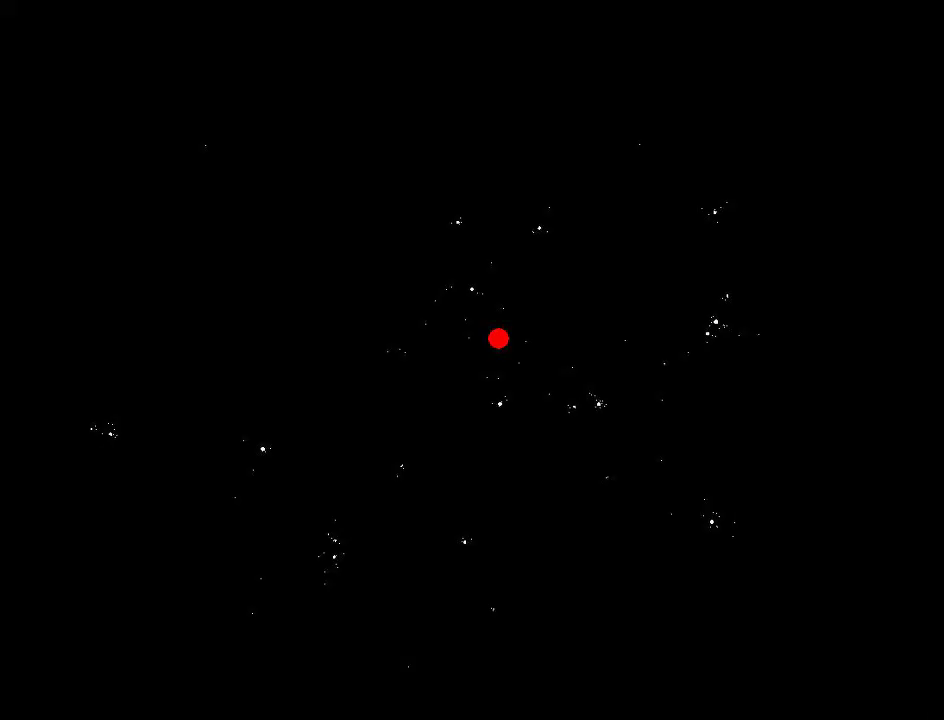  
  

## [Rust Demo Project](https://github.com/Ober3550/RustyRoboFactory)  
Dipping a toe into the rust ecosystem  
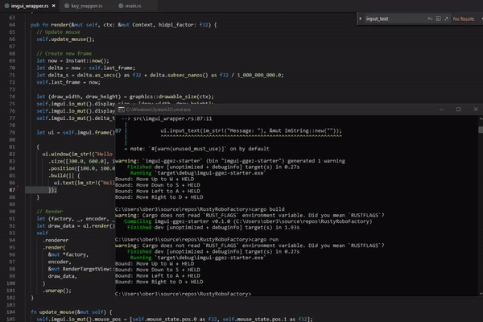  

<!-- 
## Auto Budgeter (Excel)
Automatically categorise transactions based on keywords.  
[Check it out here](https://github.com/ober3550/AutoBudget)  
 -->

## Wave Equation (Matlab)  
  
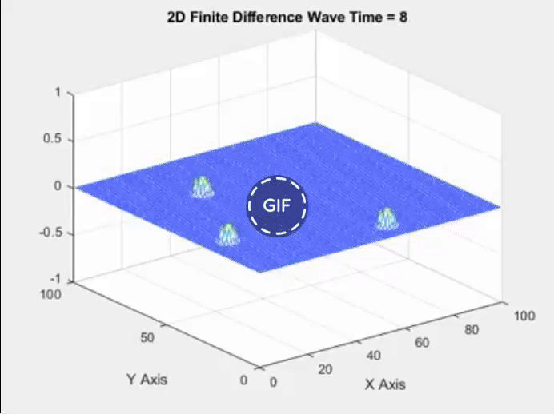  

## [Icosphere/Opengl Testing (C++, OpenGL)](https://github.com/Ober3550/My-Template)    
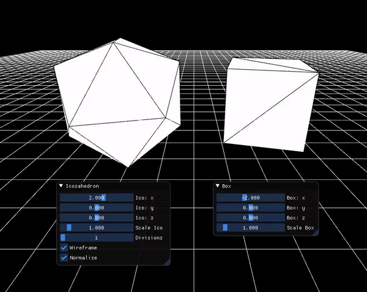   
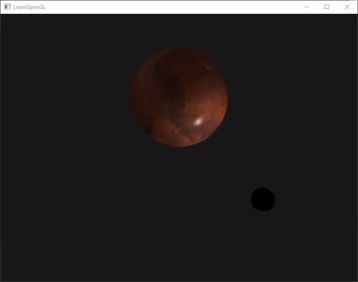   

## [Fluid Sim Project (C++, SFML, ImGui)](https://github.com/ober3550/FluidSim)   
Fluid sim project inspired by Fluid Simulation for Dummies by Mike Ash  
  

## [Ninja Platformer (P5.js)](https://ober3550.github.io/ninja.html)
  

## [Wave Function Collapse](https://ober3550.github.io/wavefunctioncollapse.html)
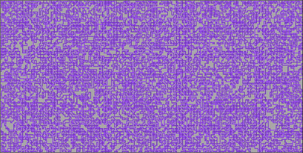  

## [Traveling Salesman](https://ober3550.github.io/TravelingSalesman.html)
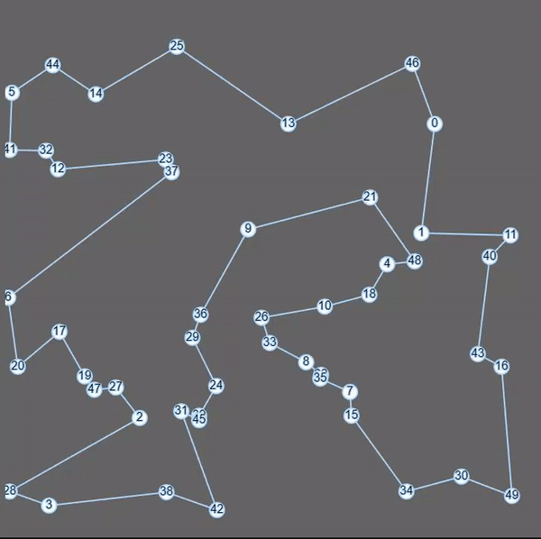  

## [Pathfinder (P5.js)](https://github.com/Ober3550/Pathfinder)
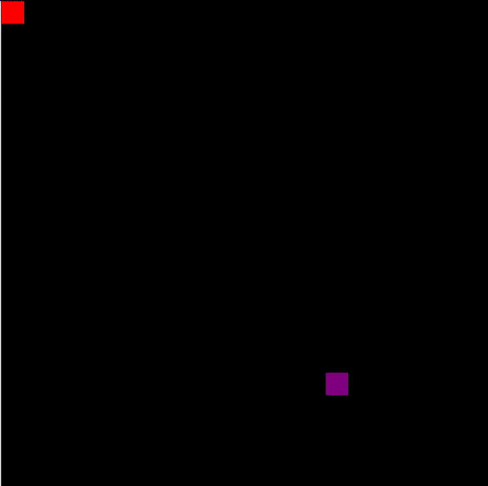  

<!-- ## Off axis bouncing (P5.js)
  

## [Tetris (P5.js)](https://github.com/Ober3550/BlockGame)
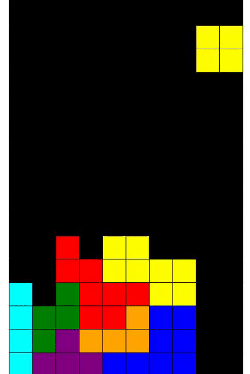    

## 2048 Game (P5.js)
  

## Beetle Render (Matlab)
  

## Pentagon Invader (C++)
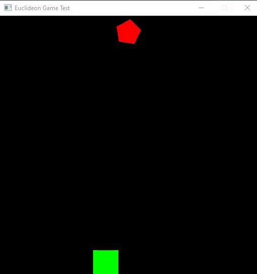  

## Brain Scan (Matlab)
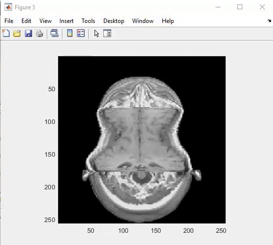  

## RoboFactory Game (C++, SFML, ImGui)  
Learning the importance of planning, long term project management and motivation toward a goal.  
[Check Out The Project for More!](https://github.com/ober3550/RobotComplex)  
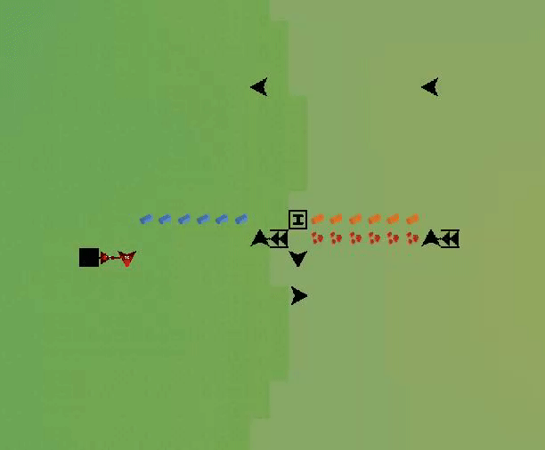

 -->
